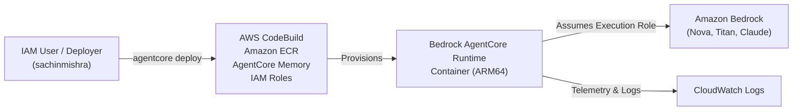

# AWS Bedrock AgentCore - IAM Policies & Permissions

### Architecture Overview



---

### 1. Direct AWS Managed Policies (Attach to IAM User)

Attach the following AWS Managed Policies to your IAM User (`sachinmishra`):

* **`AdministratorAccess`** *(Fastest for development)*

  **— OR attach these individual AWS Managed Policies —**

* **`AmazonBedrockFullAccess`**
* **`AmazonEC2ContainerRegistryFullAccess`**
* **`AWSCodeBuildAdminAccess`**
* **`IAMFullAccess`**
* **`CloudWatchLogsFullAccess`**
* **`AmazonS3FullAccess`**

---

### 2. Custom Inline Policy for `agentcore deploy`

Update your inline policy **`BedrockAgentCoreDeploymentPolicy`** in the IAM console with the following JSON (includes S3 lifecycle configurations and CloudWatch vended logs delivery):

```json
{
  "Version": "2012-10-17",
  "Statement": [
    {
      "Sid": "AgentCoreFullAccess",
      "Effect": "Allow",
      "Action": [
        "bedrock-agentcore:*",
        "agent-registry:*"
      ],
      "Resource": "*"
    },
    {
      "Sid": "ECRRepositoryAccess",
      "Effect": "Allow",
      "Action": [
        "ecr:GetAuthorizationToken",
        "ecr:DescribeRepositories",
        "ecr:CreateRepository",
        "ecr:InitiateLayerUpload",
        "ecr:UploadLayerPart",
        "ecr:CompleteLayerUpload",
        "ecr:PutImage",
        "ecr:BatchCheckLayerAvailability",
        "ecr:GetDownloadUrlForLayer",
        "ecr:BatchGetImage"
      ],
      "Resource": "*"
    },
    {
      "Sid": "CodeBuildAndLogsAccess",
      "Effect": "Allow",
      "Action": [
        "codebuild:CreateProject",
        "codebuild:StartBuild",
        "codebuild:BatchGetBuilds",
        "codebuild:BatchGetProjects",
        "logs:CreateLogGroup",
        "logs:CreateLogStream",
        "logs:PutLogEvents",
        "logs:GetLogEvents",
        "logs:DescribeLogStreams",
        "logs:PutDeliverySource",
        "logs:PutDeliveryDestination",
        "logs:CreateDelivery",
        "logs:GetDeliverySource",
        "logs:GetDeliveryDestination"
      ],
      "Resource": "*"
    },
    {
      "Sid": "IAMRoleCreationAndPassRole",
      "Effect": "Allow",
      "Action": [
        "iam:CreateRole",
        "iam:GetRole",
        "iam:AttachRolePolicy",
        "iam:PutRolePolicy",
        "iam:PassRole"
      ],
      "Resource": "*"
    },
    {
      "Sid": "S3SourceBucketAccess",
      "Effect": "Allow",
      "Action": [
        "s3:*"
      ],
      "Resource": "*"
    }
  ]
}
```
